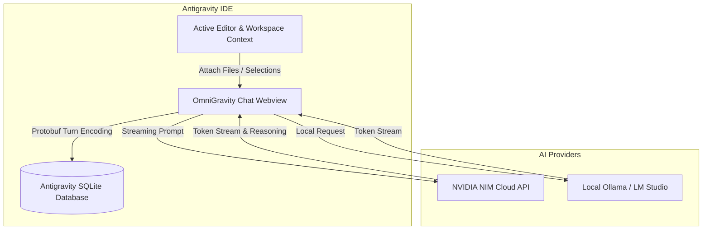

<div align="center">

<p align="center">
  <a href="#readme">English</a> •
  <a href="#readme">简体中文</a> •
  <a href="#readme">日本語</a> •
  <a href="#readme">Español</a> •
  <a href="#readme">Deutsch</a> •
  <a href="#readme">Français</a>
</p>

# OmniGravity

### One drop-in AI extension to unlock DeepSeek R1, Nemotron, Llama 3.3, and Local LLMs in Google Antigravity IDE.

<p align="center">
  <em>Never hit a quota wall again. Continue coding with high-power open reasoning models directly inside your Antigravity IDE.</em>
</p>

<p align="center">
  
  
  
  
  
  
</p>

<br/>

<table align="center">
  <tr>
    <td align="center">
      <br/>
      &nbsp;&nbsp; 🏆 &nbsp;<strong>#1 Open-Model Companion for Antigravity IDE</strong>&nbsp;&nbsp;
      <br/><br/>
    </td>
  </tr>
</table>

<br/>

<p align="center">
  <a href="#-quick-start"><b>Quick Start</b></a> •
  <a href="#-why-omnigravity"><b>Why OmniGravity</b></a> •
  <a href="#-supported-models"><b>Supported Models</b></a> •
  <a href="#-how-it-works"><b>How It Works</b></a> •
  <a href="#-features"><b>Features</b></a> •
  <a href="#-faq"><b>FAQ</b></a>
</p>

```bash
antigravity-ide --install-extension omnigravity-1.0.1.vsix
```

</div>

<br/>

> [!IMPORTANT]
> **100% Client-Side & Private**: OmniGravity runs completely inside your local Antigravity IDE. Your NVIDIA API keys and conversation databases stay strictly on your local machine. All queries travel directly from your editor to NVIDIA NIM API or your local Ollama/LM Studio instance without any intermediary tracking server.

---

## 🌟 Why OmniGravity?

| Feature | Standard Antigravity IDE Chat | 🚀 With OmniGravity |
|---|---|---|
| **Rate Limits** | Strict hourly Gemini limits; coding halts when depleted | **Unlimited** (switch to NVIDIA NIM or Local models) |
| **Model Freedom** | Gemini only (locked down) | **DeepSeek R1, Nemotron, Llama 3.3, Mistral, Ollama** |
| **Reasoning UI** | Default view | **Collapsible `🧠 Thought process`** for DeepSeek R1 |
| **Local / Offline** | Not supported | **100% offline support via Ollama & LM Studio** |
| **Session Sync** | Isolated to built-in chat | **Bi-directional SQLite Protobuf sync** |
| **Code Actions** | Standard | **1-Click `Create File`, `Apply Patch`, `Copy`** |

---

## 🤖 Supported Models

OmniGravity gives you instant access to state-of-the-art open models:

| Provider | Model | Badge | Best For |
|---|---|---|---|
| **NVIDIA NIM** | `deepseek-ai/deepseek-r1` | `Reasoning` | Complex algorithms, deep math & step-by-step logic |
| **NVIDIA NIM** | `nvidia/nemotron-3-ultra-550b-a55b` | `Flagship` | Large-scale architecture, refactoring & deep context |
| **NVIDIA NIM** | `meta/llama-3.3-70b-instruct` | `General` | Fast day-to-day coding, docs & script generation |
| **NVIDIA NIM** | `mistralai/mistral-large-2407` | `Coding` | Concise, high-precision code completions |
| **NVIDIA NIM** | `thudm/glm-5.3-flash` | `Fast` | Ultra-rapid brainstorming and quick Q&A |
| **NVIDIA NIM** | `moonshotai/kimi-k3.1-pro` | `128k` | Massive codebases and long-context documents |
| **Local Engine** | `Ollama` (`localhost:11434`) | `Local` | Completely private, offline local LLMs |
| **Local Engine** | `LM Studio` (`localhost:1234`) | `Local` | Local OpenAI-compatible model runner |

---

## 🧠 Features

### 1. Collapsible Reasoning Accordion (`<think>`)
DeepSeek R1 and reasoning models output internal chain-of-thought tokens. OmniGravity automatically parses them into a sleek collapsible accordion matching Antigravity's native aesthetics:
```
🧠 Thought process ▾
  Analyzing AST structure of active workspace...
  Resolving database sync schema...
```

### 2. Native Code Actions
Every fenced code block rendered in chat comes equipped with instant workspace actions:
* **`📄 Create File`**: Directly creates and saves the proposed file in your active workspace and opens it in the editor.
* **`📝 Apply`**: Intelligently patches and updates the target workspace file.
* **`📋 Copy`**: 1-click clipboard copy with visual feedback.

### 3. Bi-Directional Antigravity Session Sync
OmniGravity interfaces directly with Antigravity IDE's internal SQLite database (`~/.gemini/antigravity/conversations/<id>.db`). You can import any past conversation, continue it with an open model, and have every turn saved in Antigravity's native binary Protobuf format.

---

## 🏗️ How It Works



---

## 🚀 Quick Start

### 1. Prerequisites
* **Antigravity IDE** installed on Windows, macOS, or Linux.
* An NVIDIA API Key ([Get a free key at build.nvidia.com](https://build.nvidia.com/)) OR a local Ollama/LM Studio instance.

### 2. Installation
Download the latest `omnigravity-1.0.1.vsix` release and install it via the terminal or IDE:

```bash
# Using Antigravity CLI
antigravity-ide --install-extension omnigravity-1.0.1.vsix

# Or in Antigravity IDE:
# Press Ctrl+Shift+P -> "Extensions: Install from VSIX..."
```

### 3. Configuration
1. Open the **OmniGravity** icon in your left sidebar.
2. Click the model pill at the bottom (`Nemotron 3 Ultra ^`).
3. Click **Set NVIDIA API Key** and paste your key (`nvapi-...`).
4. Start coding!

---

## ⚙️ Configuration Reference

You can customize OmniGravity settings anytime in your Antigravity IDE Settings (`Ctrl+,` -> search `OmniGravity`):

| Setting | Default | Description |
|---|---|---|
| `antigravity-nvidia-chat.apiKey` | `""` | Your NVIDIA NIM API key (`nvapi-...`) |
| `antigravity-nvidia-chat.defaultModel` | `nvidia/nemotron-3-ultra-550b-a55b` | Default active model on startup |
| `antigravity-nvidia-chat.ollamaUrl` | `http://localhost:11434` | Ollama local server URL |
| `antigravity-nvidia-chat.lmstudioUrl` | `http://localhost:1234` | LM Studio local server URL |
| `antigravity-nvidia-chat.maxTokens` | `8192` | Maximum generation tokens |
| `antigravity-nvidia-chat.temperature` | `0.7` | Temperature for response creativity |

---

## ❓ FAQ

**Q: Do I have to pay to use NVIDIA NIM models?**  
A: NVIDIA provides generous free credits upon signing up at [build.nvidia.com](https://build.nvidia.com/), allowing extensive free development. Furthermore, local Ollama and LM Studio models are 100% free forever.

**Q: Will this interfere with my official Antigravity IDE chat?**  
A: Not at all! OmniGravity runs in its own dedicated sidebar tab. You can use both side-by-side or import existing sessions interchangeably.

**Q: Are my workspace files uploaded anywhere?**  
A: No. Workspace files are only read locally and included in your chat prompt when you explicitly click `Attach File` or `Add Editor Selection`.

---

## 📄 License

This project is licensed under the MIT License.
